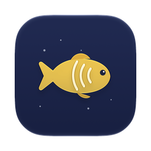
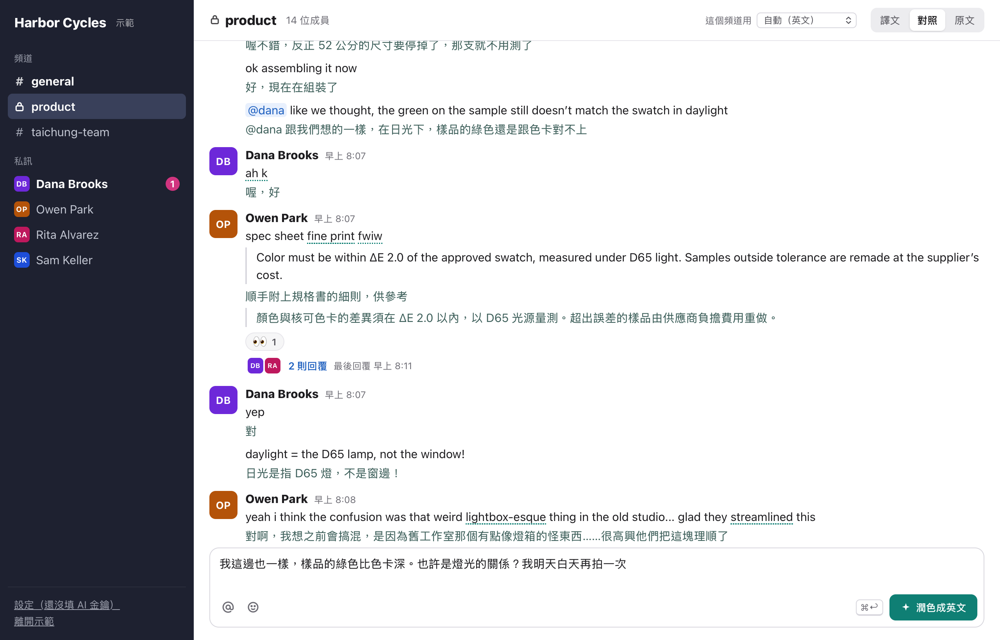
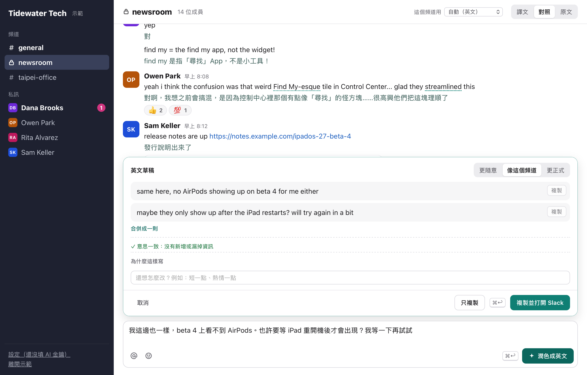
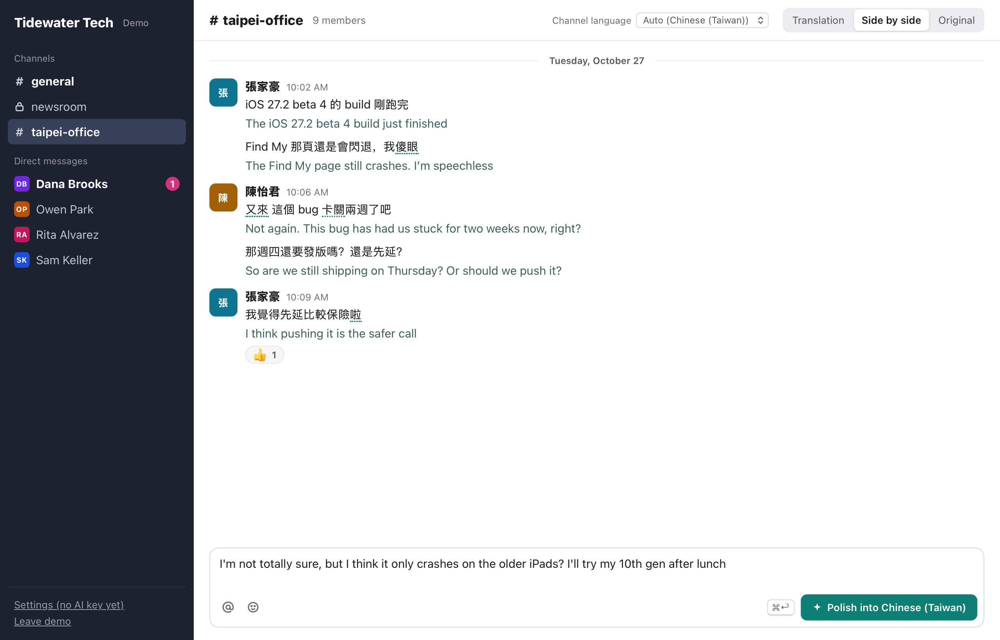
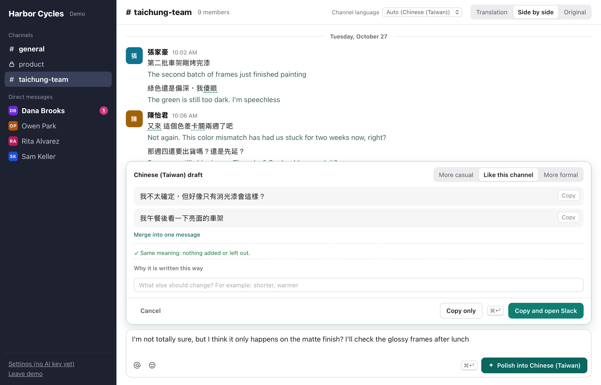

<p align="center">
  
</p>

<h1 align="center">Babel Fish</h1>

<p align="center">用自己的語言讀寫 Slack。</p>

<p align="center">
  <a href="https://github.com/surfine/babel-fish/releases/latest"><b>下載 macOS 版</b></a>（Apple 晶片，已經過 Apple 公證）
  <br>
  <a href="#babel-fish-in-english">English</a>
</p>

Babel Fish 是 macOS 上的 Slack 閱讀輔助工具，讓說中文和說英文的同事互相看懂。不是你的語言的訊息，它翻成你的語言。你用自己的語言寫回覆，它把草稿潤色成這個頻道的人會寫的樣子，再翻回你的語言，讓你確認意思沒有跑掉。

你的語言可以選英文、台灣正體、香港繁體、大陆简体或马新简体。介面也跟著換。

名字取自《銀河便車指南》裡的巴別魚：塞進耳朵，就聽得懂任何語言。





## 使用前要知道的風險

Babel Fish 不是 Slack 官方的 App，也不是工作空間安裝的 App。它借用 Slack 網頁版的登入來讀訊息。

- 這種登入方式可能違反 Slack 的使用條款。
- Slack 可能隨時讓登入失效。失效時要重新登入。
- Slack 可能跳出安全警示，並通知工作空間的管理員。
- 要翻譯的訊息會送到你設定的 AI 服務（DeepSeek 或 Anthropic）。公司頻道的內容能不能外送，請先確認。

第一次開啟時，Babel Fish 會先顯示這些風險。你勾選同意後才能登入。

## 安裝

1. 到 [Releases](https://github.com/surfine/babel-fish/releases) 下載最新的 `.dmg`。
2. 打開 `.dmg`，把 Babel Fish 拖到「應用程式」。
3. 開啟 Babel Fish，讀完風險說明後登入 Slack。

目前只有 Apple 晶片（M 系列）的版本。有新版時，側欄左下會出現「安裝新版」。

## 設定 AI 金鑰

Babel Fish 不附 AI 服務。你要自己申請金鑰：

- [DeepSeek](https://platform.deepseek.com)：只填這一把就能用全部功能，也比較便宜。
- [Anthropic](https://console.anthropic.com)：兩把都填時，翻譯用 DeepSeek，潤色用 Claude。

在側欄左下按「設定」（或選單列的 Babel Fish › 設定…，⌘,），貼上金鑰，按「儲存」。金鑰存在這台 Mac 的鑰匙圈。

沒有填金鑰時，Babel Fish 用內建的示範譯文，不會連到任何 AI 服務。

## 唯讀模式

Babel Fish 預設是唯讀模式。它只讀訊息，不會替你傳送任何東西。回覆改好後，按「複製並打開 Slack」，到官方 Slack 貼上，自己傳送。

在設定裡關掉唯讀模式後，可以直接在 Babel Fish 傳送、修改、刪除訊息，也可以加表情回應和上傳檔案。

## 我的語言與頻道語言

「我的語言」是你讀和寫的語言：英文、台灣正體、香港繁體、大陆简体或马新简体。第一次開啟時依系統語言自動選，之後可以在「設定」換。介面、譯文、俚語說明、摘要、回譯和意思比對都用它。

「頻道語言」是這個頻道的人用的語言。Babel Fish 看最近的訊息自動判斷，中文會再分繁體或簡體。判斷錯了，在頻道標題列右邊的「這個頻道用」改。

- 閱讀：不是你的語言的訊息，會翻成你的語言。設定裡「不翻譯的語言」預設跳過你自己的語言。
- 寫作：草稿潤色成頻道語言，照這個頻道的語氣寫。英文頻道看小寫開頭、縮寫和標點；中文頻道看全形或半形標點、語氣詞（啦、喔、吧）、夾不夾英文詞。
- 檢查：潤色結果另外翻回你的語言，再和你的草稿比對，標出多出來的話、漏掉的話和語氣變強變弱的地方。
- 你的語言和頻道語言相同時，潤色只調語氣，不翻譯。

中文的地區用字照[地區用詞對照表](docs/TERMINOLOGY.md)。介面的香港、大陆、马新版本由這張表加 [OpenCC](https://github.com/BYVoid/OpenCC) 從台灣正體轉成；英文介面是另外寫的。

## Babel Fish in English

Babel Fish is an unofficial macOS reader for Slack. It helps people who read English and people who read Chinese work in the same Slack.

[Download the latest release](https://github.com/surfine/babel-fish/releases/latest) for Macs with Apple silicon. The app is notarized by Apple.





- Messages that are not in your language are translated into it. Slang and internet expressions get a short note.
- You write in your own language. Babel Fish rewrites the draft in the channel's language and style, translates the result back for you, and marks anything it added, left out or made stronger or weaker.
- Babel Fish detects the language of each channel. To change it, use "Channel language" at the top of the channel.
- Set "My language" in Settings. You can pick English or four kinds of written Chinese: Taiwan, Hong Kong, mainland China, Singapore/Malaysia.

Read the risks before you use it. Babel Fish uses the Slack web sign-in, which may break Slack's terms of service. Slack can end the sign-in, and it may warn your workspace admins. The messages you translate go to the AI service you set up (DeepSeek or Anthropic). Babel Fish starts in read-only mode: you copy each reply and send it yourself in the Slack app.

## 從原始碼建置

需要 Node.js 20 以上、Rust 與 Xcode 26 以上。

```bash
npm --prefix packages/llm install
```

```bash
npm --prefix apps/shell install
```

```bash
npm --prefix apps/shell run tauri dev
```

只想看介面，不登入 Slack：

```bash
npm --prefix apps/shell run dev
```

然後打開 http://localhost:1420/?demo 。

檢查（套件測試、型別、端到端、Rust）：

```bash
scripts/check.sh
```

端到端測試第一次要先裝 WebKit：`npx --prefix apps/shell playwright install webkit`。改程式前請讀 [docs/INVARIANTS.md](docs/INVARIANTS.md)。

要自己簽章、公證並打包成 `.dmg`，見 [docs/RELEASING.md](docs/RELEASING.md)。

## 授權

MIT，見 [LICENSE](LICENSE)。
